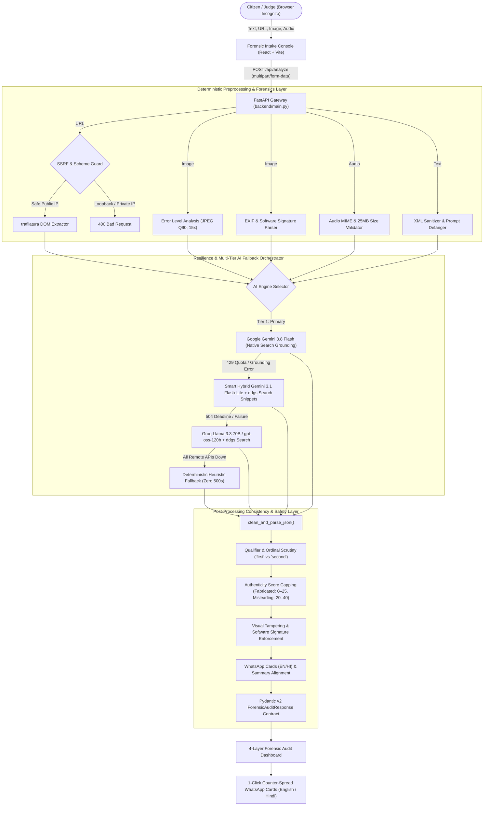
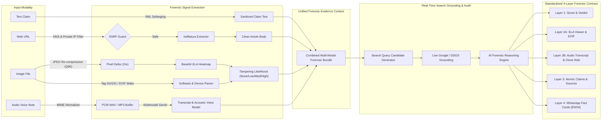

# SatyaLens (सत्यालेंस) — Real-Time Fact-Verification & Deepfake Audit Engine

[](#)
[](#)
[](#)
[](#)
[](#)
[](#)
[](#)
[](#)

> **SatyaLens** is a multi-modal, real-time fact-verification and media audit engine designed to stop viral misinformation and synthetic media across Indian digital channels. Built solo for the **NxtWave Idea Forge** hackathon (Track 1: Civic Pulse, Digital Governance & Public Information).

---

## 1. Problem Statement & Solution

### The Civic Challenge
Across Indian messaging platforms and social networks, misinformation spreads exponentially faster than corrections:
- **Altered Screenshots & Circulars:** Fabricated government notifications, doctored exam date-sheets, and spliced headlines masquerading as official announcements.
- **Viral Audio Voice Notes:** Synthetic voice clones and forwarded audio clips creating false panic, rumors of curfews, or bank failures.
- **Deceptive Qualifiers & Out-of-Context Truths:** Partial truths mixed with false ordinals (e.g., claiming a recent victory was an inaugural win) or authority spoofing ("UNESCO declared...", "WHO official circular...").
- **Friction in Counter-Messaging:** Debunking articles are often buried in dense prose that users cannot easily copy and forward into WhatsApp family or community groups.

### The SatyaLens Solution
Rather than operating as a simple LLM wrapper, **SatyaLens** pairs **deterministic Python signal forensics** (Error Level Analysis heatmaps, EXIF/editing software extraction, SSRF-hardened URL scraping) with **live Google Search grounding**, **atomic claim decomposition**, **psychological scam-hook detection**, and **1-click English/Hindi WhatsApp Fact Cards** so citizens and administrators can immediately audit claims and halt viral misinformation chains.

---

## 2. Key Capabilities & What's Built Through Step 9

SatyaLens was constructed systematically following a strict step-by-step verification methodology:

| Phase | Step | Feature / Milestone | Verification Status |
| :--- | :---: | :--- | :---: |
| **Phase 1** | **Step 1** | Backend foundational scaffolding: FastAPI, CORS, Pydantic v2 schemas, `GET /health` | Verified |
| **Phase 1** | **Step 2** | Deterministic forensics: ELA heatmap generation, EXIF metadata extraction, SSRF-safe URL scraping | Verified |
| **Phase 1** | **Step 3** | Search-grounded AI orchestration: GenAI SDK + DuckDuckGo (`ddgs`) & Groq fallback | Verified |
| **Phase 1** | **Step 4** | Unified intake router: `POST /api/analyze` supporting `text`, `url`, and `image` | Verified |
| **Phase 2** | **Step 5** | Frontend architecture: React + Vite + Tailwind CSS + `framer-motion` + `lucide-react` | Verified |
| **Phase 2** | **Step 6** | Forensic Intake Console: Text/URL/Image tabs, 3 live sample triggers, animated scan progress | Verified |
| **Phase 2** | **Step 7** | 4-Layer Forensic Audit Report: Score dial, ELA viewer, atomic claims, WhatsApp Fact Cards | Verified |
| **Phase 3** | **Step 8** | Production deployment readiness: `render.yaml`, `frontend/vercel.json`, incognito QA | Verified |
| **Phase 3** | **Step 9** | **(P1 Stretch)** Voice Note / Audio Forensics: Audio upload, speech transcription, synthetic likelihood | Verified |

---

## 3. Core & Multimodal Forensic Features

### 3.1. Multimodal Intake (`POST /api/analyze`)
SatyaLens ingests any combination of modal inputs via standard `multipart/form-data`:
- **Direct Claim Text:** WhatsApp forwards, tweets, captions, or suspicious textual statements.
- **Web Article URL:** Extracted using `trafilatura` with a hardened **SSRF/private-network guard** (`is_safe_url`) that validates URL schemes and resolves DNS to block loopback (`127.0.0.0/8`), private (`10.0.0.0/8`, `172.16.0.0/12`, `192.168.0.0/16`), multicast, link-local, and reserved IP ranges.
- **Image Forensics:**
  - **Error Level Analysis (ELA):** Deterministically re-saves images at JPEG quality 90, measures pixel-level compression variance against the original, amplifies differences ($15\times$), and returns an ELA heatmap as a base64 JPEG data URI.
  - **EXIF & Editing Software Extraction:** Extracts camera hardware metadata (Make, Model) and detects digital editing software signatures (Photoshop, GIMP, Snapseed, Canva, PicsArt, Android Gallery).
  - **Image-First Content Fallback:** When an image is uploaded without accompanying claim text, SatyaLens checks the visual content for legible text/claims first. If no claim exists (e.g. a landscape or photo), it performs pure visual/tampering integrity checks without hallucinating unrequested claims.
- **Audio Voice Note Forensics (Step 9):**
  - Accepts audio files (`.mp3`, `.wav`, `.ogg`, `.m4a`, `.aac`, `.webm`, `.flac`) up to 25 MB.
  - Passes audio buffers to Gemini multimodal ingestion or fallback pipelines.
  - Extracts the spoken claim transcript into `audio_forensics.transcript`.
  - Assesses acoustic indicators to classify `voice_synthetic_likelihood` (`None`, `Low`, `Medium`, `High`).

---

## 4. 4-Layer Forensic Audit Report

The forensic output is structured into four distinct, scannable forensic layers:

```
┌────────────────────────────────────────────────────────────────────────┐
│ Layer 1: Score & Verdict Card                                          │
│ • Authenticity Confidence Score (0–100)                                │
│ • Verdict: Verified | Misleading | Fabricated | Manipulated | Unverified│
│ • Provenance Category & Executive Audit Summary                        │
├────────────────────────────────────────────────────────────────────────┤
│ Layer 2A: Visual Forensics Panel (when has_image = true)               │
│ • Side-by-side / Toggle View: Original Image vs. ELA Heatmap            │
│ • Quantitative Metrics (Mean Error, Max Variance, Anomalous Patches)   │
│ • Camera & Editing Software Metadata Inspection                        │
├────────────────────────────────────────────────────────────────────────┤
│ Layer 2B: Audio Voice Note Forensics (when has_audio = true)           │
│ • In-Browser Audio Player & Waveform Visualizer                        │
│ • Extracted Spoken Transcript                                          │
│ • Synthetic Voice / AI Clone Likelihood Badge                          │
├────────────────────────────────────────────────────────────────────────┤
│ Layer 3: Atomic Claims & Grounded Citations                            │
│ • Individual Decomposed Claims with Status Badges                      │
│ • Contextual Debunking Explanations                                    │
│ • Clickable External Grounding Citations (Title + URL)                 │
├────────────────────────────────────────────────────────────────────────┤
│ Layer 4: Psychological Scam Flags & Counter-Spread WhatsApp Cards      │
│ • Linguistic Manipulation Triggers (False Urgency, Authority Spoofing) │
│ • Copy-Ready English Fact Card (whatsapp_card_en)                      │
│ • Copy-Ready Hindi Devanagari Fact Card (whatsapp_card_hi)             │
└────────────────────────────────────────────────────────────────────────┘
```

---

## 5. Architecture & Pipeline Flow

SatyaLens combines deterministic forensic signal processing, multi-tier resilience fallback orchestration, and post-processing consistency validation into a high-throughput, zero-auth pipeline.

### 5.1. High-Level System Architecture


### 5.2. End-to-End Forensic Request Lifecycle (Sequence Diagram)

```mermaid
sequenceDiagram
    autonumber
    actor User as Citizen / Judge
    participant UI as React Frontend
    participant API as FastAPI (main.py)
    participant Forensics as Forensics Service (forensics.py)
    participant Analyzer as AI Orchestrator (analyzer.py)
    participant DDGS as DuckDuckGo Search (ddgs)
    participant AI as AI Engine (Gemini / Groq)

    User->>UI: Submit claim, paste URL, upload photo, or attach voice note
    UI->>UI: Show animated multi-stage scanning indicator
    UI->>API: POST /api/analyze (multipart/form-data)
    
    rect rgb(20, 30, 50)
        note over API,Forensics: Deterministic Preprocessing Phase
        opt URL submitted
            API->>Forensics: extract_url_text(url)
            Forensics->>Forensics: is_safe_url() (blocks 127.0.0.1, 10.0.0.0/8, 192.168.0.0/16)
            Forensics->>Forensics: trafilatura clean HTML scraping
            Forensics-->>API: Extracted article text
        end
        opt Image submitted
            API->>Forensics: generate_ela_heatmap(image_bytes)
            Forensics->>Forensics: Re-compress Q90, calc pixel diff, amplify 15x
            Forensics->>Forensics: extract_exif_metadata() & software signature search
            Forensics->>Forensics: compute_tampering_likelihood()
            Forensics-->>API: VisualForensics(ela_heatmap_base64, tampering_likelihood, exif_summary)
        end
        opt Audio submitted
            API->>API: Validate extension (.mp3, .wav, .ogg, etc.) & max 25MB
            API->>API: Map to Gemini-compatible MIME type
        end
    end

    rect rgb(15, 35, 60)
        note over API,AI: AI Grounding & Resilience Fallback Phase
        API->>Analyzer: analyze_content(text, visual_forensics, audio_bytes)
        Analyzer->>Analyzer: sanitize_untrusted_input() (defang XML tags)
        
        alt Tier 1: Native Gemini Search Grounding
            Analyzer->>AI: models.generate_content(gemini-3.8-flash, google_search tool)
            AI-->>Analyzer: Grounded structured JSON
        else Tier 2: Smart Hybrid Gemini (on 429 Quota)
            Analyzer->>DDGS: _fetch_ddgs_snippets(query, max_results=5)
            DDGS-->>Analyzer: Real-time search snippets
            Analyzer->>AI: generate_content(gemini-3.1-flash-lite, context=search_snippets)
            AI-->>Analyzer: Grounded structured JSON
        else Tier 3: Groq LLM Fallback (on Gemini outage)
            Analyzer->>DDGS: _fetch_ddgs_snippets(query, max_results=5)
            DDGS-->>Analyzer: Real-time search snippets
            Analyzer->>AI: groq.chat.completions(llama-3.3-70b, context=search_snippets)
            AI-->>Analyzer: Grounded structured JSON
        else Tier 4: Deterministic Heuristics (Remote outage)
            Analyzer->>Analyzer: _analyze_with_heuristics_fallback()
        end
    end

    rect rgb(20, 40, 50)
        note over Analyzer,API: Consistency Guard & Contract Standardization
        Analyzer->>Analyzer: _build_forensic_response_from_json()
        Analyzer->>Analyzer: Enforce ordinal/qualifier veracity & score capping
        Analyzer->>Analyzer: Synchronize summary, English card, and Hindi card
        Analyzer-->>API: ForensicAuditResponse (Pydantic v2 validated)
    end

    API-->>UI: 200 OK (ForensicAuditResponse JSON)
    UI->>User: Render 4-Layer Forensic Audit Report & 1-Click WhatsApp Cards
```


### 5.3. Multimodal Forensics Data Pipeline


### 5.4. Multi-Tier Resilience Fallback Chain
SatyaLens implements a zero-failure degradation policy:
1. **Tier 1 (Primary):** Google GenAI SDK (`gemini-3.8-flash`, falling back to `gemini-3.1-flash-lite`) with native Google Search Grounding (`tools=[types.Tool(google_search=types.GoogleSearch())]`).
2. **Tier 2 (Smart Hybrid Gemini):** If native search grounding hits quota limits (HTTP 429), the engine queries DuckDuckGo Search (`from ddgs import DDGS`), injects fresh real-time snippets into the prompt, and retries Gemini without tool overhead.
3. **Tier 3 (Groq + DDGS):** If Gemini is completely unavailable, the request seamlessly routes to Groq (`llama-3.3-70b-versatile` / `openai/gpt-oss-120b`) paired with `ddgs` live search grounding.
4. **Tier 4 (Deterministic Heuristics):** If all external AI APIs are unreachable, deterministic Python pattern analyzers and ELA likelihood calculators return a valid structured response—**never an unhandled 500 error**.

---

## 6. Tech Stack & Development Tooling

### Frontend Architecture
- **Framework:** React 18 with Vite 6
- **Styling:** Tailwind CSS with custom dark forensic palette (`#0B1120`, `#111C33`, `#1E3A5F`, `#4DA3FF`)
- **Animation & Icons:** `framer-motion` for layered forensic transitions and `lucide-react` for technical badges
- **Design Alignment:** Tokens and component layouts derived from Stitch MCP and Magic UI patterns

### Backend Architecture
- **Runtime:** Python 3.11+
- **Web Framework:** FastAPI with Uvicorn (ASGI)
- **Data Validation:** Pydantic v2 schemas enforcing strict JSON response contracts
- **Image Processing:** Pillow (`PIL`) & NumPy for pixel difference calculation and Error Level Analysis
- **Scraping & Networking:** `trafilatura` for clean text extraction and `httpx` for asynchronous HTTP calls
- **Live Search Grounding:** DuckDuckGo Search (`ddgs>=9.0.0`)

### AI Models & APIs
- **Google GenAI SDK (`google-genai`):** `gemini-3.8-flash` & `gemini-3.1-flash-lite`
- **Groq SDK (`groq`):** `llama-3.3-70b-versatile` & `openai/gpt-oss-120b`
- **DuckDuckGo Search (`ddgs`):** Real-time web verification and news retrieval

### Developer Tools & MCP Integrations Used in Building SatyaLens
The development workflow incorporated modern agentic tools and Model Context Protocol (MCP) servers:
- **IDEs & Terminals:** VS Code (configured with Dev Containers and GitHub Copilot), Google Antigravity IDE, Warp Terminal, and Git Bash on Windows.
- **Chrome DevTools MCP:** Automated in-browser DOM inspections, responsive layout audits (375px mobile through 1440px desktop), network latency profiling, and console verification during development turns.
- **Figma & Manus.im MCPs:** Rapid component wireframing, color token extraction, and forensic layout prototyping.

---

## 7. Zero-Auth Public Incognito Access Model

SatyaLens is designed specifically for public governance and hackathon evaluation:
- **No Authentication Walls:** No login forms, passwords, user registration, JWT cookies, or OAuth flows.
- **One-Click Judge Evaluation:** Hackathon judges can open the deployment link in a clean incognito browser and immediately test any claim, image, or audio file.
- **3 One-Click Live Sample Triggers:**
  - *UNESCO Anthem Viral Forward* (Text claim test)
  - *Altered Document/Photo* (Image forensics & ELA test)
  - *Viral Audio Voice Note* (Audio forensics & transcription test)
  *(Every sample triggers a genuine `POST /api/analyze` request—never static fake data).*

---

## 8. Local Setup & Quickstart Guide

### Prerequisites
- Python 3.11 or higher
- Node.js 18 or higher (with npm)
- Git

### 1. Clone the Repository
```bash
git clone https://github.com/your-username/SatyaLens.git
cd SatyaLens
```

### 2. Backend Setup
```bash
# Navigate to backend directory
cd backend

# Create and activate Python virtual environment
# On Windows (PowerShell):
python -m venv venv
.\venv\Scripts\Activate.ps1

# On macOS/Linux:
python3 -m venv venv
source venv/bin/activate

# Install dependencies
pip install -r requirements.txt

# Configure environment variables
cp .env.example .env
```

Edit `backend/.env` with your API keys:
```env
HOST=0.0.0.0
PORT=8000
ENVIRONMENT=development
GEMINI_API_KEY=your_gemini_api_key_here
GROQ_API_KEY=your_groq_api_key_here
```

Start the backend server:
```bash
uvicorn backend.main:app --host 0.0.0.0 --port 8000 --reload
```
Verify the backend is live at `http://localhost:8000/health`.

### 3. Frontend Setup
In a new terminal window:
```bash
# Navigate to frontend directory
cd frontend

# Install Node dependencies
npm install

# Configure environment variables
cp .env.example .env
```

Ensure `frontend/.env` points to your backend instance:
```env
VITE_API_URL=http://localhost:8000
```

Start the Vite development server:
```bash
npm run dev
```
Open `http://localhost:5173` in your browser.

---

## 9. Deployment on Render & Vercel

SatyaLens is pre-configured for automated continuous deployment across modern cloud platforms.

### Backend Deployment (Render)
The repository includes a ready-to-use [`render.yaml`](file:///d:/NxtWave%20Projects/SatyaLens/render.yaml) blueprint:
1. Link your GitHub repository in the **Render Dashboard**.
2. Select **Deploy Blueprint** or create a **Web Service**:
   - **Environment:** Python 3.11.9
   - **Build Command:** `pip install -r backend/requirements.txt`
   - **Start Command:** `uvicorn backend.main:app --host 0.0.0.0 --port $PORT`
   - **Health Check Path:** `/health`
3. Configure Environment Variables in Render:
   - `GEMINI_API_KEY`: Your Google GenAI API Key
   - `GROQ_API_KEY`: Your Groq API Key

### Frontend Deployment (Vercel)
The frontend includes [`frontend/vercel.json`](file:///d:/NxtWave%20Projects/SatyaLens/frontend/vercel.json) configured with SPA route rewrites and security headers (`X-Frame-Options: DENY`, `X-Content-Type-Options: nosniff`, `Referrer-Policy: strict-origin-when-cross-origin`):
1. Import the repository into **Vercel**.
2. Set the **Root Directory** to `frontend`.
3. Framework Preset: **Vite**.
4. Configure Environment Variable:
   - `VITE_API_URL`: Your deployed Render backend URL (e.g. `https://satyalens-backend.onrender.com`).
5. Click **Deploy**.

---

## 10. API Specification

### `GET /health`
Returns service availability status.
```json
{
  "status": "ok",
  "service": "satyalens-forensics"
}
```

### `POST /api/analyze`
Accepts `multipart/form-data`:
- `text` *(optional, string)*: Text claim or forwarded message.
- `url` *(optional, string)*: Web page URL to scrape and audit.
- `image` *(optional, file)*: Image upload (`.jpg`, `.jpeg`, `.png`, `.webp`).
- `audio` *(optional, file)*: Audio voice note (`.mp3`, `.wav`, `.ogg`, `.m4a`, `.aac`, `.webm`, `.flac`).

#### Sample `200 OK` Response
```json
{
  "overall_score": 10,
  "verdict": "Fabricated",
  "provenance_category": "Social Media Forward",
  "summary": "The claim that UNESCO declared the Indian National Anthem as the best in the world is completely fabricated. UNESCO has officially clarified that no such competition or declaration exists.",
  "atomic_claims": [
    {
      "claim": "UNESCO declared the Indian National Anthem the best anthem in the world.",
      "status": "Fabricated",
      "explanation": "UNESCO has publicly refuted this claim repeatedly since 2008. No such global anthem rating was ever conducted.",
      "sources": [
        {
          "title": "UNESCO Official Clarification",
          "url": "https://en.unesco.org"
        }
      ]
    }
  ],
  "visual_forensics": {
    "has_image": false,
    "ela_heatmap_base64": null,
    "tampering_likelihood": "None",
    "exif_summary": {
      "software": null,
      "camera_model": null,
      "anomalies": []
    },
    "ela_metrics": null
  },
  "audio_forensics": {
    "has_audio": false,
    "transcript": null,
    "duration_seconds": null,
    "voice_synthetic_likelihood": "None"
  },
  "linguistic_flags": [
    {
      "trigger": "Authority Spoofing",
      "evidence": "UNESCO declares",
      "severity": "High"
    },
    {
      "trigger": "False Urgency",
      "evidence": "Forward to all groups immediately!",
      "severity": "High"
    }
  ],
  "whatsapp_card_en": "🚨 *SatyaLens Fact Check*\n*Verdict:* Fabricated (Score: 10/100)\n\n• **Claim:** UNESCO declared Jana Gana Mana as best anthem.\n• **Fact:** UNESCO never evaluates or ranks national anthems.\n\n🛡️ _Verify before forwarding with SatyaLens._",
  "whatsapp_card_hi": "🚨 *सत्यालेंस (SatyaLens) सत्यापन रिपोर्ट*\n*परिणाम:* झूठा / मनगढ़ंत (Fabricated) (विश्वसनीयता स्कोर: 10/100)\n\n• **दावा:** यूनेस्को ने राष्ट्रगान को सर्वश्रेष्ठ घोषित किया।\n• **सत्य:** यूनेस्को ने कभी कोई ऐसी घोषणा नहीं की है।\n\n🛡️ _आगे भेजने से पहले सत्यता जांचें - सत्यालेंस।_",
  "engine_used": "Google GenAI (gemini-3.8-flash)"
}
```

---

## 11. Security & Safety Controls
- **SSRF Protection:** Built-in IPv4/IPv6 private IP filtering prevents server-side request forgery against internal host services or cloud metadata endpoints (`169.254.169.254`).
- **Prompt Injection Neutralization:** All untrusted user content is defanged and isolated within strict structural XML boundaries prior to LLM evaluation.
- **File Validation & Limits:** Strict upload size limits (25MB for audio, standard image bounds) and format whitelist verification.
- **Strict Ordinal/Qualifier Scrutiny:** Double-layered prompt and code guards ensure claims with false superlatives or ordinals ("first" vs "second") are caught and capped at low authenticity scores.

---

## 12. License
Distributed under the **MIT License**. See `LICENSE` for details. Built with pride for the NxtWave **Idea Forge** Hackathon.
