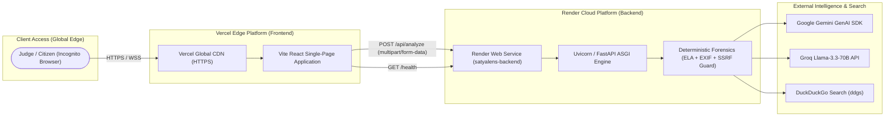

# SatyaLens — Full Deployment Guide (Render + Vercel)

This production deployment guide walks you through deploying **SatyaLens** to production ahead of hackathon evaluation:
- **Backend REST API:** Deployed on **Render** (FastAPI, Python 3.11+, Uvicorn, health checks, multi-tier AI fallback).
- **Frontend Client:** Deployed on **Vercel** (Vite, React 18, Tailwind CSS, Edge CDN, SPA rewrites, security headers).
- **Access Model:** **Zero-Auth Public Incognito Mode** — judges and users can test live immediately with zero login or database barriers.

---

## 1. Architecture & Deployment Topology



---

## 2. Prerequisites & Credentials Checklist

Before beginning, ensure you have:
1. **GitHub Repository:** Your code pushed to a GitHub repository (e.g., `https://github.com/your-username/SatyaLens`).
2. **Render Account:** [render.com](https://render.com) (free tier is fully supported).
3. **Vercel Account:** [vercel.com](https://vercel.com) (free hobby tier is fully supported).
4. **API Keys:**
   - `GEMINI_API_KEY`: Google AI Studio API Key ([aistudio.google.com](https://aistudio.google.com/app/apikey)).
   - `GROQ_API_KEY`: Groq Cloud API Key ([console.groq.com](https://console.groq.com/keys)).

> [!IMPORTANT]
> Always deploy the **Backend on Render first**. You need the deployed Render backend URL (e.g. `https://satyalens-backend.onrender.com`) to configure `VITE_API_URL` on Vercel.

---

## 3. Step 1: Deploy Backend to Render

### Option A: 1-Click Blueprint Deploy via `render.yaml` (Recommended)
The repository includes a pre-configured [`render.yaml`](render.yaml) blueprint file.

1. Log into your [Render Dashboard](https://dashboard.render.com).
2. Click **New +** in the top navigation and select **Blueprint**.
3. Connect your GitHub repository (`SatyaLens`).
4. Render will automatically detect [`render.yaml`](render.yaml) and parse the configuration:
   - **Service Name:** `satyalens-backend`
   - **Runtime:** `Python 3.11.9`
   - **Plan:** `Free`
   - **Build Command:** `pip install -r backend/requirements.txt`
   - **Start Command:** `uvicorn backend.main:app --host 0.0.0.0 --port $PORT`
   - **Health Check Path:** `/health`
5. Under **Environment Variables**, supply your secret keys:
   - `GEMINI_API_KEY`: *(paste your Google Gemini API key)*
   - `GROQ_API_KEY`: *(paste your Groq API key)*
6. Click **Apply**. Render will initiate the build and deploy.

---

### Option B: Manual Web Service Setup on Render
If you prefer configuring via the web dashboard without the Blueprint:

1. In the [Render Dashboard](https://dashboard.render.com), click **New +** $\to$ **Web Service**.
2. Connect your GitHub repository.
3. Configure the following fields **exactly as shown**:
   | Setting | Value | Explanation |
   | :--- | :--- | :--- |
   | **Name** | `satyalens-backend` | Your service identifier |
   | **Region** | `Oregon (US West)` or nearest | Any standard region |
   | **Branch** | `main` | Production branch |
   | **Root Directory** | *(leave blank)* | Root of repository |
   | **Runtime** | `Python 3` | Python runtime |
   | **Build Command** | `pip install -r backend/requirements.txt` | Installs FastAPI, GenAI, Pillow, etc. |
   | **Start Command** | `uvicorn backend.main:app --host 0.0.0.0 --port $PORT` | Starts the production ASGI server |
   | **Plan** | `Free` | Zero-cost hackathon tier |
4. Scroll down to **Advanced** $\to$ **Add Environment Variable**:
   | Key | Value | Notes |
   | :--- | :--- | :--- |
   | `PYTHON_VERSION` | `3.11.9` | Locks Python version |
   | `GEMINI_API_KEY` | *(your Gemini key)* | Primary GenAI grounding |
   | `GROQ_API_KEY` | *(your Groq key)* | Fallback LLM engine |
   | `ENVIRONMENT` | `production` | Production mode |
5. Under **Advanced Settings**, set **Health Check Path** to `/health`.
6. Click **Create Web Service**.

---

### Verifying the Backend Deployment
Once the deployment status turns green (**Live**):
1. Copy your Render service URL (e.g., `https://satyalens-backend.onrender.com`).
2. Test the health check endpoint in your terminal or browser:
   ```bash
   curl -i https://satyalens-backend.onrender.com/health
   ```
   **Expected Response:**
   ```json
   HTTP/2 200
   content-type: application/json

   {
     "status": "ok",
     "service": "satyalens-forensics"
   }
   ```

> [!NOTE]
> **Render Free Tier Cold Starts:** Free instances on Render spin down after 15 minutes of inactivity. When accessed after inactivity, the first request may take ~50–60 seconds to spin up. Subsequent requests respond in milliseconds.

---

## 4. Step 2: Deploy Frontend to Vercel

You can deploy either the original frontend (`frontend/`) or the new design (`frontend02/`). Both are pre-configured with `vercel.json` for SPA routing and security headers.

### Deploying the Primary Frontend (`frontend/`)
1. Log into your [Vercel Dashboard](https://vercel.com/dashboard).
2. Click **Add New...** $\to$ **Project**.
3. Import your GitHub repository (`SatyaLens`).
4. In the **Configure Project** screen:
   - **Project Name:** `satyalens` (or your preferred name)
   - **Framework Preset:** `Vite` *(auto-detected)*
   - **Root Directory:** Click **Edit** and select **`frontend`**
5. Expand **Build and Output Settings** (confirm defaults):
   - **Build Command:** `npm run build`
   - **Output Directory:** `dist`
   - **Install Command:** `npm install`
6. Expand **Environment Variables** and add:
   | Key | Value | Example |
   | :--- | :--- | :--- |
   | `VITE_API_URL` | *(Your Render Backend URL)* | `https://satyalens-backend.onrender.com` |

   > [!WARNING]
   > Do **NOT** include a trailing slash in `VITE_API_URL` (use `https://satyalens-backend.onrender.com`, NOT `https://satyalens-backend.onrender.com/`).

7. Click **Deploy**. Vercel will build the frontend in ~25–35 seconds and assign a production URL (e.g. `https://satyalens.vercel.app`).

---

### Deploying the New Design (`frontend02/`) — Optional
If you wish to deploy the new Material Dark design with Word Rotator, Hero Reveal, Count-Up Stats, Us vs Them, and Review Shuffle:
1. In Vercel, set the **Root Directory** to **`frontend02`** instead of `frontend`.
2. Keep the same environment variable:
   - `VITE_API_URL`: `https://satyalens-backend.onrender.com`
3. Click **Deploy**.

---

## 5. End-to-End Incognito Verification Checklist

Open your live deployed Vercel URL in an **Incognito / Private browser window** and verify the full forensic pipeline:

- [ ] **1. Header Health Pill:** Observe the status pill in the top header. It should turn green and display `Core Active` / `Online` after pinging `/health`.
- [ ] **2. Sample 1 (Viral Forward Text):**
  - Click the **Viral Forward** sample button (*UNESCO Anthem*).
  - Confirm the multi-stage scan animation displays.
  - Verify the report loads with `Verdict: Fabricated` (Score $\le 20$), atomic claims, and WhatsApp English/Hindi cards.
- [ ] **3. Sample 2 (Fact-Check URL):**
  - Click the **Fact-Check URL** sample.
  - Confirm `trafilatura` extracts article text without SSRF errors.
- [ ] **4. Sample 3 (Image Forensics):**
  - Click the **Image Forensics** sample (*Forged ₹5000 note*).
  - Verify Layer 2A renders with the **Original Image** and **ELA Heatmap** toggle.
- [ ] **5. Sample 4 (Voice Note Audio):**
  - Click the **Voice Note** sample.
  - Verify Layer 2B displays the audio player, transcript, and synthetic-voice likelihood badge.
- [ ] **6. WhatsApp Card Copy:**
  - Click **Copy Fact Card** on either English or Hindi tab.
  - Confirm the checkmark changes to `Copied!` and paste the text into any editor to confirm formatting.

---

## 6. Troubleshooting & Common Pitfalls

### 1. "Failed to Fetch" or Network Error on Analyze
- **Cause:** `VITE_API_URL` is either missing, pointing to `http://localhost:8000`, or Render backend is still in cold-start sleep.
- **Fix:** 
  1. Open your Render backend URL in a new tab (`https://satyalens-backend.onrender.com/health`) to wake it up.
  2. Verify in **Vercel Settings $\to$ Environment Variables** that `VITE_API_URL` is set to `https://<your-service>.onrender.com`.
  3. Trigger a redeploy on Vercel (**Deployments $\to$ Redeploy**) after changing environment variables.

### 2. CORS (Cross-Origin Resource Sharing) Errors
- **Observation:** Browser console displays `Cross-Origin Request Blocked`.
- **Status in SatyaLens:** In [`backend/main.py`](backend/main.py), CORS is already configured with:
  ```python
  app.add_middleware(
      CORSMiddleware,
      allow_origins=["*"],
      allow_credentials=True,
      allow_methods=["*"],
      allow_headers=["*"],
  )
  ```
  This allows requests from any Vercel domain (`*.vercel.app`) out of the box.

### 3. Gemini 429 RESOURCE_EXHAUSTED Quota
- **Status in SatyaLens:** SatyaLens has an automatic **4-Tier Resilience Fallback Chain**:
  1. `gemini-3.8-flash` (Native Search Grounding)
  2. `gemini-3.1-flash-lite` with DDGS Search Grounding
  3. `Groq llama-3.3-70b-versatile` with DDGS Search Grounding
  4. Deterministic Python Heuristics Fallback
- Even if your Gemini API hits 429 daily rate limits, requests will automatically succeed via **Groq + DDGS** or **Heuristics** with zero `500` server crashes. Ensure your `GROQ_API_KEY` is added in Render environment variables.

### 4. 404 Not Found on Page Refresh on Vercel
- **Cause:** Single-Page Applications (SPA) require rewriting all routes to `index.html`.
- **Status in SatyaLens:** Both [`frontend/vercel.json`](frontend/vercel.json) and [`frontend02/vercel.json`](frontend02/vercel.json) include:
  ```json
  {
    "rewrites": [{ "source": "/(.*)", "destination": "/index.html" }]
  }
  ```
  Direct URL navigation and page refreshes work properly without 404 errors.

---

## 7. Useful Deployment Commands

### Trigger Render Manual Deploy via Git
Any push to the `main` branch will automatically trigger a new build on both Render and Vercel:
```powershell
git add .
git commit -m "chore: trigger production deployment"
git push origin main
```

### Quick Backend Health Probe
```powershell
# PowerShell
Invoke-RestMethod -Uri "https://satyalens-backend.onrender.com/health"
```

### Local Production Build Simulation
To test the production build locally before pushing:
```powershell
# Test Frontend build
cd frontend
npm run build
npm run preview
```
